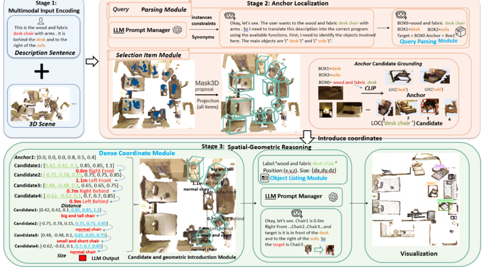
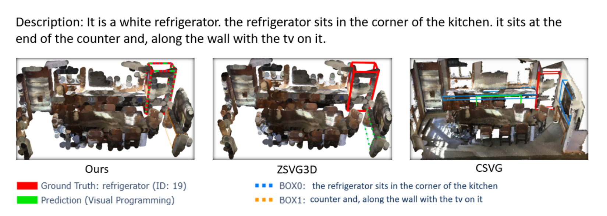

# LEGU-3D: LLM-Guided Explicit Geometric Understanding for 3D Visual Grounding

<p>
  
  
  
  
  
</p>

**Siyu Wang** and **Jian Zhang** · University of Technology Sydney
*IEEE International Conference on Visual Communications and Image Processing (VCIP), 2026*
`TODO: paper link (IEEE Xplore / arXiv)`

<p align="center"></p>

---

## Overview

3D visual grounding localises the object a sentence refers to in a point-cloud scene, e.g. *"the wood and fabric desk chair with arms, behind the desk and to the right of the sofa."*

Zero-shot methods hand this to an LLM, but two things go wrong:

1. **Parsing long descriptions.** Keyword parsing treats words like "fabric" or "arms" as object categories, so the target is misidentified.
2. **Implicit geometry.** Giving an LLM raw coordinates and asking it to work out "behind" or "closest" requires numerical reasoning that LLMs do unreliably.

**LEGU-3D** computes the geometry deterministically and gives the LLM a structured query and a structured candidate list, so it compares instead of calculates:

| Module | What it does |
|---|---|
| **Query Parsing Module (QPM)** | Prompts the LLM with a restricted JSON schema to split the query into BOX slots: `BOX0` = target, `BOX1/BOX2` = anchors. Attribute phrases stay attached to the target. |
| **Object Listing Module (OLM)** | Turns candidates into an attribute table **sorted by distance to the anchor**, so selection becomes a table lookup. |
| **Dense Coordinate Module (DCM)** | For each candidate, computes Euclidean distance to the anchor, full box size **W×H×D**, and a quadrant label (e.g. *left-front*), and writes them into the prompt as plain text. |

```text
{BOX0: "wood and fabric desk chair with arms", BOX1: "desk", BOX2: "sofa"}

id   dist    size (W×H×D)         direction
17   0.6 m   0.60×0.60×0.90 m     right-back
21   1.1 m   0.70×0.70×0.80 m     left-back
34   1.9 m   0.50×0.50×0.90 m     right-front
                                  → LLM picks id 17
```
<sub>Illustrative prompt content.</sub>

No training, no proprietary API: a single locally served **Qwen3-32B** on 2 × NVIDIA L4.

---

## Results

### Nr3D (ground-truth boxes, Top-1 %)

| Method | Setting | Easy | Hard | Dep. | Indep. | Overall |
|---|---|---|---|---|---|---|
| BUTD-DETR | fully supervised | 60.7 | 48.4 | 46.0 | 58.0 | 54.6 |
| ZSVG3D | zero-shot, no GT class | 46.5 | 31.7 | 36.8 | 40.0 | 39.0 |
| VoG-2B | zero-shot, no GT class | 40.3 | 22.6 | 30.4 | 31.5 | 31.1 |
| **LEGU-3D** | zero-shot, no GT class | 52.3 | 37.0 | 36.5 | 48.7 | **44.4** |
| SeeGround (70B) | zero-shot, no GT class | 54.5 | 38.3 | 42.3 | 48.2 | 46.1 |
| VLM-Grounder | zero-shot, GT class | 55.2 | 39.5 | 45.8 | 49.4 | 48.0 |
| CSVG (123B) | zero-shot, GT class | 67.1 | 51.3 | 53.0 | 62.5 | 59.2 |
| **LEGU-3D (32B)** | zero-shot, GT class | 65.2 | 45.9 | 43.2 | 61.7 | **55.2** |

With GT class labels, the zero-shot LEGU-3D (55.2) is above the fully supervised BUTD-DETR (54.6).

### ScanRefer (Mask3D predicted boxes, validation set)

| Method | LLM | Unique @.25 | Unique @.50 | Multiple @.25 | Multiple @.50 | Overall @.25 | Overall @.50 |
|---|---|---|---|---|---|---|---|
| ScanRefer (supervised) | — | 65.0 | 43.3 | 30.6 | 19.8 | 37.3 | 24.3 |
| ZSVG3D | GPT-3.5 | 63.8 | 58.4 | 27.7 | 24.6 | 36.4 | 32.7 |
| ZSVG3D (our repro.) | Qwen3-32B | 52.3 | 47.7 | 24.0 | 21.2 | 30.9 | 27.6 |
| VLM-Grounder | GPT-4V | 66.0 | 29.8 | 48.3 | 33.5 | 51.6 | 32.8 |
| UniGround | GPT-5 | — | — | — | — | 46.1 | 34.1 |
| CSVG | Mistral-Large (123B) | 68.8 | 61.2 | 38.4 | 27.3 | 49.6 | 39.8 |
| **LEGU-3D** | **Qwen3-32B** | 66.1 | 59.8 | 30.3 | 25.8 | **44.4** | **39.3** |

+8.0 / +6.6 points over the reported ZSVG3D on Overall @0.25 / @0.50, and +6.3 on Multiple @0.25 over the same-backbone reproduction — the split where same-class objects must be told apart.

### Ablations

<table>
<tr><td>

**Modules (ScanRefer, Overall)**

| QPM | OLM | DCM | @.25 | @.50 |
|:-:|:-:|:-:|:-:|:-:|
| | ✓ | | 40.4 | 36.0 |
| ✓ | ✓ | | 42.1 | 37.5 |
| ✓ | ✓ | ✓ | **44.4** | **39.3** |

</td><td>

**LLM backbone (Nr3D, Overall)**

| Backbone | Overall |
|---|:-:|
| Gemma-4-27B | 50.6 |
| Qwen2.5-32B | 52.3 |
| **Qwen3-32B** | **55.2** |

</td></tr>
</table>

**Efficiency (Nr3D, medians):** 8 candidates per query; the OLM table adds ~200 tokens to a ~550-token prompt; ~3.4 s LLM inference per query on 2 × L4.

### Qualitative example

<p align="center"></p>

LEGU-3D finds the refrigerator in a multi-anchor kitchen scene, where ZSVG3D and CSVG fail from parsing or spatial-reasoning errors.

**Limitation.** DCM's directional labels are coarse (left/right, front/behind), so near-ties on Hard, View-Dependent and Multiple queries fall back to the nearest candidate. Future work will explore finer-grained angular descriptors and full open-vocabulary deployment.

---

## Getting started

### Repository layout

```text
LEGU-3D/
├── gen_visprogapple.py              # QPM: parse Nr3D queries into programs (Qwen3-32B)
├── llm_grounding.py                 # OLM + DCM grounding and Nr3D evaluation
├── generate_scanrefer_baseline.py   # QPM program generator for ScanRefer
├── prompts/
│   ├── prompt_n32.txt               # QPM prompt (Nr3D)
│   └── prompt_n32_gemma.txt         # QPM prompt (ScanRefer)
├── scripts/run_nr3d.sh              # launch / resume a Nr3D run
└── zsvg/                            # direction labels, geometry, checkpointing, target resolution
```

ScanRefer evaluation code will be released later.

### Environment

```bash
pip install -r requirements.txt
```

Tested on Ubuntu with Python 3.9.12. The grounding code itself only needs `numpy`, `requests`, `tqdm`, `jsonlines` and `torch` (to read the feature file); the LLM is served separately with [vLLM](https://github.com/vllm-project/vllm).

### Data

Data is not included in this repository. Follow the [ZSVG3D](https://github.com/CurryYuan/ZSVG3D) preprocessing to obtain:

```text
data/
├── nr3d.jsonl                         # Nr3D annotations (ReferIt3D)
└── scannet/
    ├── feats_3d.pkl                   # scene objects: boxes + class labels
    └── splits/scannetv2_val.txt
```

### 1. Serve the LLM

```bash
python -m vllm.entrypoints.openai.api_server \
  --model Qwen/Qwen3-32B-AWQ \
  --gpu-memory-utilization 0.98 \
  --max-model-len 4096 \
  --max-num-seqs 1 \
  --enforce-eager \
  --port 8000
```

If your server requires a key, set `VLLM_API_KEY` (defaults to `EMPTY`).

### 2. Parse queries (QPM)

```bash
python gen_visprogapple.py \
  --nr3d_path data/nr3d.jsonl \
  --prompt_path prompts/prompt_n32.txt \
  --output data/nr3d_qwen3_feats.json \
  --resume
```

### 3. Ground and evaluate on Nr3D (OLM + DCM)

```bash
# runs detached and resumes from its checkpoint if restarted
scripts/run_nr3d.sh

# or directly
python llm_grounding.py \
  --prog_path data/nr3d_qwen3_feats.json \
  --feats_pkl data/scannet/feats_3d.pkl \
  --direction-scheme quadrant \
  --exp_name legu3d_nr3d
```

Useful options: `--max_samples N` for a quick test, `--no_dcr` for the distance-ordering ablation, `--direction-scheme {quadrant,compass,compass_cutoff}` to change how directions are phrased. Results are written to `<exp_name>.log`. All LLM calls use temperature 0.

---

## Citation

```bibtex
@inproceedings{wang2026legu3d,
  title     = {LLM-Guided Explicit Geometric Understanding for 3D Visual Grounding},
  author    = {Wang, Siyu and Zhang, Jian},
  booktitle = {IEEE International Conference on Visual Communications and Image Processing (VCIP)},
  year      = {2026}
}
```

## Acknowledgements

Built on [ZSVG3D](https://github.com/CurryYuan/ZSVG3D) (Yuan et al., CVPR 2024). Benchmarks: [ScanRefer](https://github.com/daveredrum/ScanRefer), [ReferIt3D / Nr3D](https://github.com/referit3d/referit3d), [ScanNet](http://www.scan-net.org/). Candidate proposals from [Mask3D](https://github.com/JonasSchult/Mask3D).
